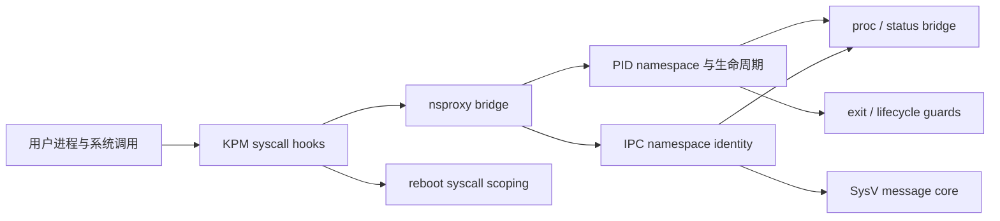

# 架构说明

## 目标与边界

项目通过 KernelPatch Module（KPM）适配目标设备现有内核，不重建内核。当前目标内核未提供本项目所需的原生 PID/IPC namespace 行为；KPM 在用户态系统调用入口和 namespace/proc 状态之间提供一层设备特定的 fake namespace 适配。

行为参考是 [Dere3046/_patchHarmony](https://github.com/Dere3046/_patchHarmony) 的固定源码版本（见 [NOTICE](../NOTICE.md)）。它使用面向 GKI 6.x 的 LKM 与自己的 hook/符号解析机制；本项目针对 Linux 4.19 和 KernelPatch loader 重新审计符号、字段、权限及对象生命周期。上游能力清单用于发现差距，不能直接当作当前设备已支持的功能。

目标是逐项参照上游源码实现相应功能，优先保持其对象模型、状态转换及 syscall 语义，并针对 Linux 4.19/KPM 的实际 ABI 调整。实现状态必须以挂接的状态对象、`/proc` 表现和隔离测试为依据；仅返回成功的 `unshare()` 不符合目标。当前通过范围仍以设备证据为准。

## 组件关系

## 代码职责

| 文件/组件 | 作用 |
| --- | --- |
| `dagu_v02.c` | KPM 元数据、符号/ABI 初始化、系统调用 hook 生命周期与退出路径 |
| `abi.h` | 目标内核 ABI 与结构布局约束；偏移不能直接从其他 Android 内核移植 |
| `nsproxy_bridge.c` | `unshare()`、`clone()`、`setns()` 相关 PID/IPC 请求与 fake namespace 状态的连接 |
| `pid_namespace.c`、`pid_lifecycle.c` | PID namespace 状态、进程身份和生命周期管理 |
| `ipc_namespace.c` | IPC namespace identity 与对象状态连接 |
| `msg_core.c`、`msg_syscalls.c` | 当前实现的 SysV message queue 核心和系统调用路径 |
| `sem_core.c`、`shm_core.c`、`sysv_syscalls.c` | SysV semaphore 与 shared memory 核心，四个 semaphore 与四个 shared memory 系统调用共用 `el0_svc_common` 拦截 |
| `mqueue.c` | `mqueue` 文件系统类型：复制 `shmem_fs_type` 改名注册 |
| `nat66.c`、`nat66/*.c` | IPv6 NAT：内核 netfilter 源码经 `nat66/shim.c` 间接调用，注册由内核线程延迟执行 |
| `userns.c` | User namespace：命名空间记录、凭据安装、挂载路径与 superblock 归属修正 |
| `userns_proc.c` | User namespace：在 `/proc/<pid>` 下补回 `uid_map`、`gid_map`、`setgroups` |
| `userns_ns.c` | User namespace：在 `/proc/<pid>/ns` 下补回 `user` 条目 |
| `macvlan_ko/dagu_macvlan.c` | 独立编译的 macvlan link type 模块：注册 `rtnl_link_ops` 与 netdevice 通知，下级设备挂 `rx_handler`，按目的地址与模式分发并统计收发 |
| `mqueue_core.c`、`mqueue_syscalls.c` | POSIX 消息队列：队列对象挂在 fake IPC namespace 上，`mq_*` 系统调用经 `el0_svc_common` 拦截 |
| `proc_bridge.c`、`status_bridge.c`、`proc_mount_refs.c`、`proc_root_dedup.c` | namespace link、`/proc` 状态与挂载引用表现 |
| `pid_exit_guard.c` | PID 1 退出相关保护逻辑 |
| `reboot_syscalls.c` | Droidspaces 停止路径使用的 scoped reboot 行为 |
| `usercopy.c` | 用户地址与内核数据之间的受控复制辅助函数 |
| `tests/*.c` | ARM64 设备上的 namespace、IPC 和 `setns()` 行为探针 |

## 一次 PID/IPC 请求的路径

1. KPM 初始化时解析目标 loader/内核可用符号并安装系统调用 hook。
2. `unshare()`、`clone()` 或受支持的 `setns()` 请求进入 `nsproxy_bridge.c`。
3. bridge 根据请求建立或切换 fake PID/IPC 状态，并更新相关进程关联；内核未实现的 namespace 路径仍可能返回错误。
4. `/proc` 和进程状态桥接代码呈现 PID/IPC namespace identity；SysV message 路径按 fake IPC 状态隔离消息队列。
5. 生命周期与退出保护代码负责清理状态，避免当前设备已知的 PID 1 退出陷阱。

这是一条按源码模块划分的概念路径。具体行为受目标 boot 的 ABI、KernelPatch 版本及各 syscall 覆盖范围约束。

## 当前支持边界

在已验证设备上，PID/IPC `unshare()`、PID 1、部分 `clone()`/`setns()` 路径、SysV 消息队列隔离及 Droidspaces 核心容器流程通过记录的检查；后续开发候选版本完成有界的并发容器和 `setns()` 矩阵检查。以下尚未实现或未验收：任意 `setns()` 组合、非恒等 id 映射、完整硬件访问和完整上游功能对等；macvlan 由独立模块提供，未实现在本仓库的 KPM 内。`devtmpfs` 文件系统类型已实现，节点填充由消费方完成。

这些是此开发快照的已知缺口，不应描述为已经支持或已经证明不可能实现。user namespace 和通用硬件访问还缺少安全且可验证的目标 ABI/生命周期路径；POSIX mqueue 的 `mq_notify` 未实现。有限的并发与 `setns()` 检查不证明任意组合或规模均正确。详见[限制与未实现功能](LIMITATIONS.md)。

## 维护约束

- 结构体偏移和符号锚点必须针对目标 boot 重新审计。
- hook/loader 生命周期与回滚路径是代码评审重点。
- KPM 产物和设备日志属于构建/运行结果，不提交到源码仓库。
- 新行为需同步更新测试、支持边界和外部依赖来源。
